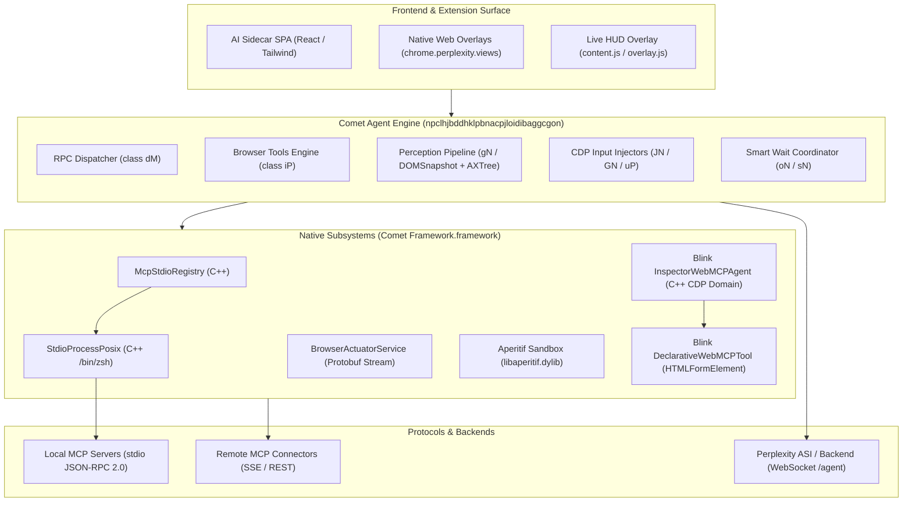

# Comet Browser (`ai.perplexity.comet`) Complete Architectural & Automation Deep Dive

## 1. Architectural Anatomy & Binary Layout

**Comet** is Perplexity's AI-native web browser built on a modified downstream branch of **Chromium 154.0.8037.179** for macOS Apple Silicon (`arm64`).



### 1.1 Filesystem Blueprint
- **Main App Bundle**: `/Applications/Comet.app`
  - `Contents/MacOS/Comet`: Mach-O 64-bit arm64 executable launcher (138 KB).
  - `Contents/Frameworks/Comet Framework.framework/Versions/Current/Comet Framework`: Core Chromium engine binary (~200 MB).
  - `Contents/Frameworks/Comet Framework.framework/Versions/Current/Libraries/libaperitif.dylib`: Custom seatbelt sandbox wrapper with PartitionAlloc default memory zones.
  - `Contents/Frameworks/Comet Framework.framework/Versions/Current/Resources/resources.pak`: DataPack v5 container containing 7,225 resources, WebUI mojom bindings, and Perplexity frontend modules.
  - `Contents/Resources/scripting.sdef`: AppleScript scripting definitions (`CrSu` Chromium suite).
- **Installed Extension Layer (`~/Library/Application Support/Comet/Default/Extensions/`)**:
  - `npclhjbddhklpbnacpjloidibaggcgon` (**`comet-agent`**, v0.0.231): Full autonomous Computer-Use agent engine (`background.js`, `content.js`, `overlay.js`, `events.js`).
  - `mcjlamohcooanphmebaiigheeeoplihb` (**`Comet Core`**, v1.0.83): Internal browser control bridge, Google Docs assistant, Chrome Web Store integration (`hyperbridge.modern.js`, `background.ts.js`).
  - `mjdcklhepheaaemphcopihnmjlmjpcnh` (**`Comet Web Resources`**, v2026.6.29.323): Bundled offline Single Page Applications (SPAs) powering Sidecar, Computer Tasks, and Voice Assistant (`spa/`, `sidecar/`, `voice-assistant/`, `inline-assistant/`).

---

## 2. Model Context Protocol (MCP) Deep Dive

Comet implements MCP at two foundational levels: **Native Stdio Subprocesses** and **Declarative WebMCP in the Blink Rendering Engine**.

### 2.1 Native Stdio MCP Daemon (`components/perplexity/mcp/`)

The native stdio daemon is implemented in C++ and compiled directly into the `Comet Framework`.

#### Internal C++ Source Modules
- `components/perplexity/mcp/mcp_stdio_registry.cc`:
  - Enforces server name validation: Latin letters, numbers, underscores, and hyphens (`[a-zA-Z0-9_\-]`).
  - Persists configurations in browser preferences under `perplexity.mcp.stdio_servers` and `perplexity.mcp.approved_custom_servers`.
  - Re-hydrates servers on browser launch: `AsyncNotifyOnPersistedServersLoaded`.
- `components/perplexity/mcp/mcp_stdio_client.cc`:
  - Enforces the MCP JSON-RPC 2.0 protocol over standard I/O streams.
  - Formats requests: `initialize`, `notifications/initialized`, `tools/list`, and `tools/call`.
- `components/perplexity/mcp/stdio_process_posix.cc` & `stdio_process.cc`:
  - Spawns subprocesses using `/bin/zsh`.
  - Creates POSIX pipes (`pipe(stdin)`, `pipe(stdout)`, `pipe(stderr)`).
  - Emits diagnostics: `[pplx] Launching process with command: ...`, `[pplx] MCP stdio client process started with PID ...`.
- `components/perplexity/mcp/mcp_env_loader_mac.cc`:
  - Executes `GetUserEnvsForMcpStdio` on macOS to extract user shell variables (`PATH`, `NODE_PATH`, `HOME`), enabling child processes to locate CLI runtimes (`npx`, `python3`, `uv`, `bun`).
- `chrome/browser/perplexity/mcpbicon_source.cc`:
  - Serves custom `mcpbicon://` protocol icons for registered MCP tools.

#### The JavaScript API Definition (`chrome.perplexity.mcp`)
Exposed in `Comet Framework` to privileged extensions:

```typescript
interface StdioServer {
  name: string;
  command: string;
  env: Record<string, any>;
  status: "pending" | "running" | "stopped" | "error";
  tools_count: number;
  unparsed_output: string;
  dxt_name?: string;
}

interface Tool {
  name: string;
  description: string;
  schema: Record<string, any>; // JSON Schema
}

namespace chrome.perplexity.mcp {
  function getStdioServers(callback: (servers: StdioServer[]) => void): void;
  function addStdioServer(serverName: string, command: string, env: Record<string, any>, callback: (server: StdioServer) => void): void;
  function updateStdioServer(existingServerName: string, updateData: { name: string; command: string; env: Record<string, any> }, callback: (server: StdioServer) => void): void;
  function removeStdioServer(serverName: string, callback: () => void): void;
  function getTools(serverName: string, callback: (tools: Tool[]) => void): void;
  function callTool(serverName: string, toolName: string, args: Record<string, any>, callback: (result: Record<string, any>) => void): void;

  const onPersistedStdioServersLoaded: ChromeEvent<() => void>;
  const onStdioServerAdded: ChromeEvent<(server: StdioServer) => void>;
  const onStdioServerRemoved: ChromeEvent<(serverName: string) => void>;
  const onStdioServerChanged: ChromeEvent<(serverName: string, changes: Partial<StdioServer>, server: StdioServer) => void>;
}
```

### 2.2 Declarative WebMCP in Blink Engine

Comet integrates the emerging **WebMCP** specification into Blink, allowing web documents to provide native tools to the browser agent without UI clicks.

#### C++ Symbols in Blink
- `blink::HTMLFormElement::ScheduleDeclarativeWebMCPToolRegistration()`: Automatically turns HTML form declarations with MCP attributes into machine-readable tool schemas.
- `blink::ModelContext::ExecuteDeclarativeTool(...)`: Native execution target when an agent invokes a declared DOM tool.
- `blink::InspectorWebMCPAgent`: CDP agent forwarding web tools to DevTools and the browser agent.

#### CDP Domain: `WebMCP`
```
WebMCP.invokeTool       (command: executes a tool against a document)
WebMCP.toolsAdded       (event: notifies agent that newly loaded page declared tools)
WebMCP.toolsRemoved     (event: fired when tool-declaring DOM elements are removed)
WebMCP.toolInvoked      (event: trace hook when invocation begins)
WebMCP.toolResponded    (event: returns tool output payload)
```

---

## 3. Autonomous Browser Automation Engine (`comet-agent`)

The core automation engine resides in `~/Library/Application Support/Comet/Default/Extensions/npclhjbddhklpbnacpjloidibaggcgon/0.0.231_0/background.js`.

### 3.1 The ComputerBatch Action Loop (`class iP`)

The core execution engine implements Anthropic Computer-Use semantics:

```javascript
// Actual implementation from comet-agent background.js
iP = class {
  deps;
  lastViewport;
  constructor(deps) {
    this.deps = deps;
  }

  async ComputerBatch(payload) {
    let tabId = payload.tab_id ?? -1;
    let actions = payload.actions ?? [];
    let externalMsg = this.deps.externalMessagesManager;
    let viewportInfo = await eP(tabId, this.deps.logger);
    
    let clickActions = ["LEFT_CLICK", "RIGHT_CLICK", "DOUBLE_CLICK", "TRIPLE_CLICK"];
    let spatialActions = [...clickActions, "SCROLL", "LEFT_CLICK_DRAG"];
    
    // Viewport Dimension Drift Check
    let hasDrifted = _P(this.lastViewport, viewportInfo);
    if (actions.some(({ action }) => action && spatialActions.includes(action)) && hasDrifted) {
      let { screenshotUuid, base64_image, newViewportInfo } = await this.takeScreenshot(tabId);
      return {
        tab_context: await this.getTabContext(tabId, newViewportInfo),
        error: "Actions were not executed as viewport dimensions have been changed. " +
               "Previous screenshots and coordinates are no longer valid. " +
               "Use the new screenshot provided to continue.",
        base64_image,
        screenshot_uuid: screenshotUuid
      };
    }

    let debuggee = { tabId };
    let osPlatform = await pj();
    let waitCoordinator = oN({
      tabContext: { tabId, scopedLogger: this.deps.logger, mainTabId: -1 },
      config: { action: `ComputerBatch`, waitForFCP: false, maxWaitingTimeoutMs: 2500 }
    });
    let results = [];
    let screenshotUuid = BA();

    for (let [idx, actionItem] of actions.entries()) {
      if (this.deps.abortController?.signal.aborted) break;
      if (!actionItem.action) continue;

      this.deps.overlayManager?.onAction(tabId, actionItem.action.toLowerCase());

      let actionResult = await hA(actionItem.action)
        .with("SCREENSHOT", async () => "Successfully captured screenshot scaled to viewport dimensions")
        .with("WAIT", async () => {
          await oj(actionItem.duration * 1000);
          return `Waited for ${actionItem.duration} second(s)`;
        })
        .with("LEFT_CLICK", "RIGHT_CLICK", "DOUBLE_CLICK", "TRIPLE_CLICK", async () => {
          let normalized = await vP(tabId, viewportInfo, actionItem);
          let clickCounts = { DOUBLE_CLICK: 2, TRIPLE_CLICK: 3 };
          let [scaledX, scaledY] = gP(normalized.coordinate, viewportInfo);
          let btn = normalized.action === "RIGHT_CLICK" ? "right" : "left";
          let count = clickCounts[normalized.action] ?? 1;

          this.deps.overlayManager?.onClickAction(tabId, scaledX, scaledY).catch(() => {});
          
          let target = normalized.ref ? nj(normalized.ref).targetId : undefined;
          let targetDebuggee = target ? { targetId: target } : { tabId };

          await JN(targetDebuggee, GN(targetDebuggee, osPlatform)).click(scaledX, scaledY, {
            button: btn,
            clickCount: count
          });
          return `Clicked on tab ${tabId}`;
        })
        .with("TYPE", async () => {
          await uP(debuggee, actionItem.text, false);
          return `Typed "${actionItem.text}" on tab ${tabId}`;
        })
        .with("KEY", async () => {
          await GN(debuggee, osPlatform).press(actionItem.text);
          return `Pressed ${actionItem.text}`;
        })
        .with("SCROLL", async () => {
          let [x, y] = gP(actionItem.coordinate, viewportInfo);
          return `Scrolled in ${await this.doScroll(tabId, actionItem.scroll_parameters, x, y)} direction`;
        })
        .with("LEFT_CLICK_DRAG", async () => {
          let [startX, startY] = gP(actionItem.start_coordinate, viewportInfo);
          let [endX, endY] = gP(actionItem.coordinate, viewportInfo);
          let mouse = JN(debuggee, GN(debuggee, osPlatform));
          await mouse.move(startX, startY);
          await mouse.down();
          await mouse.move(endX, endY);
          await mouse.up();
          return "Dragged from start coordinate to end coordinate";
        })
        .with("SCROLL_TO", async () => {
          let { object, debuggee: targetDebuggee } = await dP(tabId, actionItem.ref);
          await yP(targetDebuggee, object.objectId);
          return `Scrolled to element with reference: ${actionItem.ref}`;
        })
        .otherwise(() => {
          throw new lM(`Unsupported action ${actionItem.action}`);
        });

      results.push(actionResult);
      // Random inter-action humanization delay (50 - 150ms)
      if (idx !== actions.length - 1) await oj(Math.floor(Math.random() * 101) + 50);
    }

    await waitCoordinator.wait();
    let { base64_image, newViewportInfo } = await this.takeScreenshot(tabId, { screenshotUuid });

    return {
      tab_context: await this.getTabContext(tabId, newViewportInfo),
      message: JSON.stringify(results),
      base64_image,
      screenshot_uuid: screenshotUuid
    };
  }
};
```

### 3.2 Coordinate Scaling and Bounding Box Reconciliation

The coordinate math coordinates screenshots against browser viewport CSS pixels:

```javascript
// Real implementation from background.js
var hP = (viewport) => viewport.viewportWidth / viewport.screenshotWidth;

var gP = (coords, viewport) => {
  let scale = hP(viewport);
  return [coords[0] * scale, coords[1] * scale];
};

var _P = (lastViewport, currentViewport) => {
  return !!lastViewport && (
    lastViewport.viewportWidth !== currentViewport.viewportWidth ||
    lastViewport.viewportHeight !== currentViewport.viewportHeight
  );
};

// Resolves element references ('ref') into center coordinates
var vP = async (tabId, viewport, action) => {
  if (!action.ref) return action;
  let { object, debuggee, nodeId } = await dP(tabId, action.ref);
  
  // Instant center scroll
  await yP(debuggee, object.objectId);
  
  // Query CDP DOM.getBoxModel
  let box = await bP(debuggee, nodeId);
  return {
    ...action,
    coordinate: [
      Math.round((viewport.screenshotWidth / viewport.viewportWidth) * box[0]),
      Math.round((viewport.screenshotHeight / viewport.viewportHeight) * box[1])
    ]
  };
};
```

### 3.3 Typing & Clipboard Emulation (`uP`)

To avoid triggering bot detection and handle complex inputs (React, Slate, Lexical editors):

```javascript
var uP = async (debuggee, text, clearFirst = false, mimeType = null) => {
  let keyboard = GN(debuggee, await pj());
  
  if (clearFirst) {
    await keyboard.press("ControlOrMeta+KeyA");
  }
  
  if (text === "") {
    await keyboard.press("Backspace");
    return;
  }

  // Fast path: Attempt CDP Input.pasteFromString
  let pasteSuccess = await mj(debuggee, text);
  if (!pasteSuccess) {
    // Fallback: Safe Clipboard Swap
    await ej("paste", debuggee, async () => {
      try { window._savedClipboard = await navigator.clipboard.read(); } catch {}
    });
    
    // Inject custom payload into clipboard
    await ej("paste", debuggee, async (val, mime) => {
      let item = new ClipboardItem({ "text/plain": val, ...(mime && { [mime]: val }) });
      await navigator.clipboard.write([item]);
    }, [text, mimeType]);
    
    // Dispatch native paste shortcut
    await keyboard.press("ControlOrMeta+KeyV");
    
    // Restore user's previous clipboard state
    await ej("paste", debuggee, async () => {
      if (window._savedClipboard) {
        try { await navigator.clipboard.write(window._savedClipboard); } 
        finally { delete window._savedClipboard; }
      }
    });
  }
};
```

### 3.4 Hybrid Perception Engine: YAML Accessibility Tree (`gN`)

Comet combines `Accessibility.getFullAXTree` and `DOMSnapshot.captureSnapshot` to generate an indexed accessibility document:

```javascript
var gN = async (options) => {
  let { debuggee, scaleMultiplier } = options;
  let [dpr, domSnapshot, axTree, origin] = await Promise.all([
    X(debuggee, "Runtime.evaluate", { expression: "window.devicePixelRatio || 1" }),
    X(debuggee, "DOMSnapshot.captureSnapshot", { computedStyles: ["cursor"] }),
    X(debuggee, "Accessibility.getFullAXTree", {}),
    X(debuggee, "Runtime.evaluate", { expression: "window.location.origin" })
  ]);

  let scale = dpr.result?.value || 1;
  let layoutMap = pN(domSnapshot, scale, scaleMultiplier);
  return {
    output: await _N(options, axTree.nodes, layoutMap, debuggee.targetId, 0, origin.result?.value || "")
  };
};
```
Elements receive an integer `ref` mapping to `backendDOMNodeId`, letting the LLM choose between clicking `[x, y]` coordinates or specifying `ref: 42` for structural interactions (`form_input`, `scroll_to`).

### 3.5 RPC Error Recovery & Detach Healing (`class dM`)

The RPC layer wraps every action in self-healing retry logic:
- **Debugger Detachment**: If the user moves a window or Chrome detaches the debugger (`"Debugger is not attached to the tab with id"`), `dM` automatically re-attaches (`await IA(tabId)`) and retries the command.
- **Debugger Timeout**: If a command hangs, it reloads the tab (`chrome.tabs.reload(tabId)`), reattaches, and retries once before failing.
- **Subagent Spawning (`CreateSubagent`)**: Spawns isolated worker agents in hidden background tabs (`is_subagent: true`, `isHidden: true`).

---

## 4. Real-Time Streaming & UI Middlewares

In `spa-shell-DjX4AiQc.js`, the Perplexity UI listens to server-sent events or WebSocket chunks via `StreamMiddlewares`, routing tool calls instantly:

```javascript
// Middleware handler from spa-shell
if (chunk.entropy_request_content) {
  // Initiates multi-step autonomous browsing
  let tasks = chunk.entropy_request_content.tasks;
  tasks.forEach(task => {
    agentClient.submitTask({
      action: "startAgentFromPerplexity",
      type: "START_AGENT",
      extra_headers: chunk.entropy_request_content.extra_headers,
      base_url: chunk.entropy_request_content.base_url,
      ...task
    });
  });
} else if (chunk.connect_comet_to_asi_content) {
  // Connects directly to Agent Streaming Interface (ASI)
  agentClient.connectAsi(chunk.connect_comet_to_asi_content);
} else if (chunk.browser_get_cookies_content) {
  // Extracts session cookies for authenticated sites
  let cookies = await agentClient.getCookies();
  sendResponse(cookies);
} else if (chunk.browser_get_visible_tab_screenshot_content) {
  // Takes screenshot and uploads to AWS S3 bucket
  let screenshot = await agentClient.GetVisibleTabScreenshot();
  let s3Url = await uploadToS3(screenshot.data_url);
  sendResponse({ screenshot_url: s3Url });
}
```

---

## 5. Visual HUD & Confirmation Gates

### 5.1 The Floating Overlay (`overlay.js` / `content.js`)
When active, `comet-agent` injects:
1. An outer blurred gradient boundary (`filter: blur(24px)`, `borderImage: var(--pplx-overlay-gradient)`).
2. An animated rotating conic gradient:
```css
@property --a {
  syntax: '<angle>';
  initial-value: 0deg;
  inherits: false;
}
@keyframes a {
  to { --a: 1turn; }
}
```
3. A control button with ID `pplx-agent-0_0-overlay-stop-button`: toggles `"Pause Comet Assistant"` and `"Resume Comet Assistant"`.
4. Click ripples rendered at `[scaledX, scaledY]` upon every simulated mouse click.

### 5.2 User Confirmation Handlers
For sensitive actions (passwords, checkout, downloads):
- **`WAIT_FOR_BROWSER_AGENT_CONFIRMATION`**:
  - `ALWAYS_ALLOW`: Sets cookie `pplx.browser.always-allow-browser-agent = true`.
  - `ALLOW_ONCE`: Sends `{ browser_agent_action: "ALLOW_ONCE" }` to backend.
  - `SKIP`: Discards action and asks the agent to find an alternative route.

---

## 6. Native macOS Integrations & Enterprise Security

1. **Aperitif Seatbelt Sandbox (`libaperitif.dylib`)**:
   Custom seatbelt profile intercepting Darwin Mach lookup ports:
   `(allow mach-lookup (global-name "com.apple.cfprefsd.agent") (global-name "com.apple.trustd.agent"))`.
2. **CrowdStrike ZTA Integration**:
   Directly parses `/Library/Application Support/CrowdStrike/ZeroTrustAssessment/data.zta` to verify corporate device posture.
3. **AppleScript Scripting Dictionary (`scripting.sdef`)**:
   Implements Chromium Suite commands:
   - `execute javascript` (`CrSuExJa`): Runs arbitrary JavaScript in a tab.
   - `reload`, `go back`, `go forward`, `view source`, `save`, `close`.
4. **Remote DevTools Tunneling (`chrome.perplexity.devtoolsRemote`)**:
   Exposes a randomized TCP debugging port with a cryptographically secure token: `{ port: number, token: string }`.
