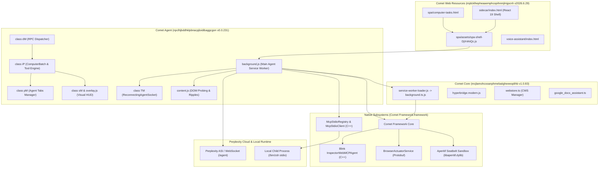

# 02. Module Dependency Map & Architecture Topology

## 1. Overview & System Boundaries

The Perplexity Comet browser (`ai.perplexity.comet`) executes as a partitioned multi-tier system spanning native Chromium C++ extensions, three core system extensions, and a local/cloud streaming interface.



---

## 2. Core Extension Specifications

### 2.1 `comet-agent` (`npclhjbddhklpbnacpjloidibaggcgon`)
- **Version**: `0.0.231` (Build Hash: `a7360d243f17512c03a102560dda5d35495cf9d0`)
- **Manifest Version**: MV3 Service Worker (`background.js`, 773 KB).
- **Declared Permissions**:
  `activeTab`, `cookies`, `scripting`, `storage`, `tabs`, `debugger`, `webNavigation`, `webRequest`, `sessions`, `history`, `offscreen`, `file://*/`, `declarativeNetRequestWithHostAccess`, `clipboardWrite`, `clipboardRead`, `tabGroups`, `downloads`, `downloads.ui`, `nativeMessaging`, `alarms`.
- **Externally Connectable**:
  `https://perplexity.ai/*`, `https://www.perplexity.ai/*`, `https://staging.perplexity.ai/*`, `https://testing.perplexity.ai/*`.

#### Main Class & Module Structure:
| Class / Symbol | File / Offset | Responsibility | Inputs | Outputs |
| :--- | :--- | :--- | :--- | :--- |
| `class AP` | `background.js` @ 613K | `TaskLifecycleCoordinator` — oversees WebSocket connection, task start/stop, and RPC routing. | `initialPayload`, `socket`, `tabManager`, `rpcService` | Task completion status |
| `class dM` | `background.js` @ 496K | `RpcService` — handles incoming JSON-RPC calls, validates safety parameters, routes to `iP`. | `{ request_id, method, request }` | Serialized JSON response or `handleError` |
| `class iP` | `background.js` @ 589K | `BrowserToolsEngine` — executes `ComputerBatch`, `ReadPage`, `Navigate`, `FormInput`, `TabsCreate`. | Action parameters, element references, coordinates | Action execution receipts, base64 screenshot, tab context |
| `class pM` | `background.js` @ 499K | `AgentTabsManager` — tracks active task tabs, auto-dismisses JavaScript dialogs, manages Tab Groups. | `initialPayload`, `taskContextPayload` | Tab allocation, focus control, cleanup |
| `class sM` | `background.js` @ 482K | `OverlayManager` — drives DOM visual HUD and mouse click feedback. | `tabId`, click coordinates `[x, y]` | HUD state messages to content scripts |
| `class TM` | `background.js` @ 519K | `ReconnectingAgentSocket` — resilient WebSocket client for cloud connection with auto-reconnect. | `baseUrl`, `endpoint: "/agent"` | Event emission, task resumption payloads |

---

### 2.2 `Comet Core` (`mcjlamohcooanphmebaiigheeeoplihb`)
- **Version**: `1.0.83` (Build Hash: `1.0.83-e1e89fb65f`)
- **Manifest Version**: MV3 Module Service Worker (`service-worker-loader.js` $\to$ `assets/js/background.ts.DnBXLLQH.js`).
- **Declared Permissions**:
  `debugger`, `alarms`, `identity`, `tabs`, `offscreen`, `idle`, `processes`, `storage`, `unlimitedStorage`, `webNavigation`, `webRequest`, `bookmarks`, `history`, `search`, `sessions`, `proxy`, `tabGroups`, `notifications`, `contentSettings`, `scripting`, `settingsPrivate`, `cookies`, `declarativeNetRequest`, `declarativeNetRequestFeedback`, `declarativeNetRequestWithHostAccess`, `management`.
- **Apparent Responsibilities**:
  1. Low-level browser bridge (`hyperbridge.modern.D9CpFzSY.js`) connecting web views to Chrome internal settings.
  2. Chrome Web Store proxy (`webstore.ts.BRkxV_PV.js`) allowing direct installation and update of extensions from `chromewebstore.google.com`.
  3. Google Docs integration (`google_docs_assistant.ts.awjem-hm.js`) enabling contextual text editing inside Google Docs canvas and iframes.
  4. Offscreen audio/DOM rendering coordinator (`pages/offscreen.js`).

---

### 2.3 `Comet Web Resources` (`mjdcklhepheaaemphcopihnmjlmjpcnh`)
- **Version**: `2026.6.29.323` (Build Hash: `baefc7c19607bf15499f848f7c9c6a5003d71351`)
- **Manifest Version**: MV3 Static Web Resources (`web_accessible_resources`).
- **Declared Accessibility**:
  Exposes `sidecar/*`, `spa/*`, `voice-assistant/*`, `inline-assistant/*` directly to `https://www.perplexity.ai/*`.
- **Apparent Responsibilities**:
  1. Supplies the client-side SPA bundle (`spa/assets/spa-shell-DjX4AiQc.js`) powering Perplexity within the browser.
  2. Embeds the native Sidecar companion UI (`sidecar/index.html`).
  3. Implements the Computer Tasks and Workflows management panels (`spa/computer-tasks.html`, `spa/computer-task.html`).
  4. Houses the frontend Model Context Protocol configuration modals (`MCPServerModal`, `MCPServiceToolsModal`).

---

## 3. Detailed Call Paths & Entry Point Catalog

### Entry Point 1: `START_AGENT`
- **Trigger**: External message sent to `comet-agent` via `chrome.runtime.onMessageExternal`.
- **Caller**: `spa-shell-DjX4AiQc.js` upon receiving stream chunk `entropy_request_content`.
- **Input Payload**:
  ```json
  {
    "type": "START_AGENT",
    "uuid": "task-uuid-string",
    "task": "User instruction prompt",
    "base_url": "https://www.perplexity.ai",
    "extra_headers": "{\"source\":\"sidecar\",\"enable_reconnect\":true}",
    "use_current_page": false,
    "thread_url_slug": "..."
  }
  ```
- **Execution Path**:
  1. Handled by `_z` in `background.js`.
  2. Dispatches to `kP(payload, { windowId })`.
  3. Validates base URL host (`AM(baseUrl)`).
  4. Instantiates `TM` (ReconnectingAgentSocket), `kj` (externalMessagesManager), `sM` (overlayManager), `pM` (tabsManager).
  5. Instantiates `iP` (browserTools) with abort controller and preferences.
  6. Wraps in `dM` (rpcService) and launches `AP.startTaskWrapper()`.
- **Failure Behavior**: If host validation fails, logs error and returns; if task UUID already exists in `Ro`, logs warning and rejects.

### Entry Point 2: `CONNECT_ASI` (Agent Streaming Interface)
- **Trigger**: External message sent via `chrome.runtime.onMessageExternal`.
- **Caller**: Perplexity backend stream requesting direct low-latency WebSocket connection.
- **Input Payload**:
  ```json
  {
    "type": "CONNECT_ASI",
    "payload": {
      "ws_url": "wss://...",
      "request_id": "...",
      "tab_group_id": 12,
      "entry_uuid": "...",
      "context_uuid": "...",
      "current_tab_ids": [101, 102],
      "features": {}
    }
  }
  ```
- **Execution Path**:
  1. Handled by `_z` in `background.js`.
  2. Calls `iL({...})` passing parameters and session configuration `zL()`.
  3. Returns `{ success: true, response: { comet_session_id } }`.
- **Failure Behavior**: Catches exception, returns `{ success: false, error: String(e) }`.

### Entry Point 3: `CALL_TOOL` (Synchronous Tool Dispatch)
- **Trigger**: External message via `chrome.runtime.onMessageExternal`.
- **Caller**: Sidecar or external Perplexity client executing a one-off browser tool.
- **Input Payload**:
  ```json
  {
    "type": "CALL_TOOL",
    "method": "GetContent" | "SearchBrowser" | "GetSidecarContext" | "OpenTab",
    "request": {
      "request_id": "req-123",
      "key": "step-456",
      "pages": [{ "url": "https://example.com" }]
    }
  }
  ```
- **Execution Path**:
  1. Handled by `uz(message, sender)`.
  2. Instantiates `iz` (ToolService).
  3. Invokes `iz[method](request)`.
  4. Logs metrics and payload size.
  5. Returns `{ success: true, response: e }` or `{ success: false, response: dz(error) }`.
- **Failure Behavior**: Maps error types via `dz`: `sj` $\to$ `"timeout"`, `sz` $\to$ `"blocked-by-user"`, `cz` $\to$ `"schema-error"`.

### Entry Point 4: `MOVE_THREAD_TO_SIDECAR`
- **Trigger**: External message via `chrome.runtime.onMessageExternal`.
- **Caller**: User clicking "Open in Sidecar" or automated task transition.
- **Execution Path**:
  1. Finds target window's `sidecarTabId`.
  2. Collects active task tabs (`tR(activeTaskUuid)`).
  3. Marks task tabs as opened (`wj(tabId, { opened: "opened" })`).
  4. Invokes native API `chrome.perplexity.sidecar.open({ windowId, animate, takeFocus })`.
  5. Connects port `Io.get(sidecarTabId)` to migrate thread state.
- **Failure Behavior**: Returns `{ success: false, error: "No sender tab found" }` or `"No task tabs found"`.

---

## 4. Evidence Classification Table

| Finding / Relationship | Source Artifact | Class / Symbol | Evidence Level |
| :--- | :--- | :--- | :--- |
| `comet-agent` uses CDP 1.3 to control browser | `npclhjbddhklpbnacpjloidibaggcgon/background.js` | `chrome.debugger.attach` | **A (Direct Evidence)** |
| `class dM` routes RPC requests to `class iP` | `npclhjbddhklpbnacpjloidibaggcgon/background.js` | `dM.dispatchRpcRequest` | **A (Direct Evidence)** |
| `class iP` executes Anthropic Computer-Use action loop | `npclhjbddhklpbnacpjloidibaggcgon/background.js` | `iP.ComputerBatch` | **A (Direct Evidence)** |
| `START_AGENT` instantiates `TM` (ReconnectingAgentSocket) | `npclhjbddhklpbnacpjloidibaggcgon/background.js` | `kP` | **A (Direct Evidence)** |
| `Comet Core` provides Chrome Web Store proxy | `mcjlamohcooanphmebaiigheeeoplihb/assets/js/webstore.ts` | `webstore.ts` | **A (Direct Evidence)** |
| `Comet Web Resources` serves offline React SPA | `mjdcklhepheaaemphcopihnmjlmjpcnh/spa/assets/` | `spa-shell-DjX4AiQc.js` | **A (Direct Evidence)** |
| Native stdio daemon is implemented in C++ | `Comet Framework.framework` | `mcp_stdio_registry.cc` | **A (Direct Evidence)** |
