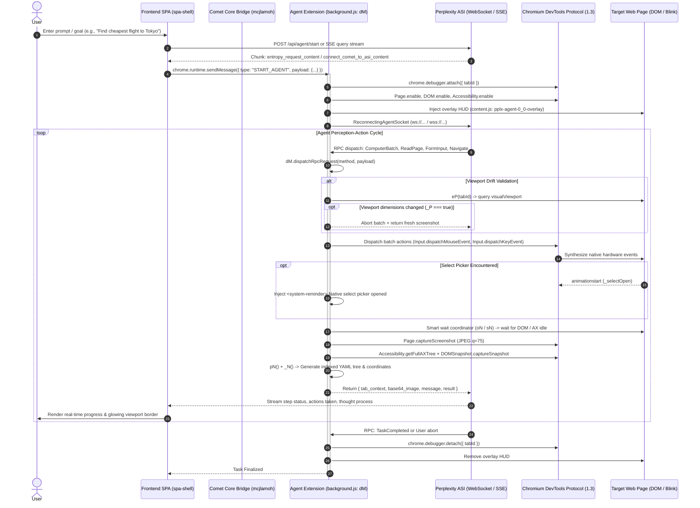
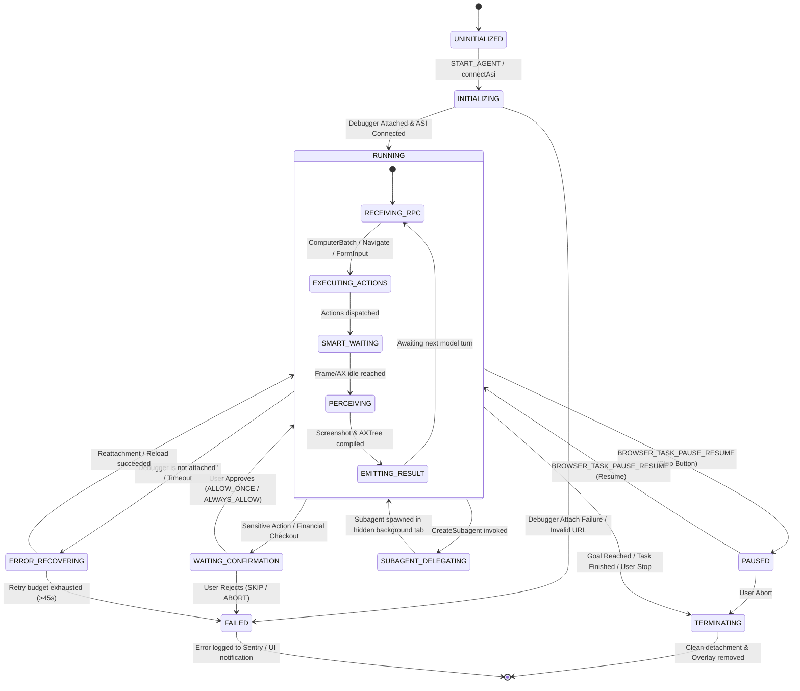

# 03 — Agent Execution Lifecycle & State Machine

## 1. Executive Overview

The Comet Browser agent execution lifecycle is an asynchronous, event-driven, hybrid perception-action loop coordinated between three distinct layers:
1. **Frontend Presentation & Stream Layer**: Bundled React Single Page Application (`spa-shell-DjX4AiQc.js`) running inside extension `mjdcklhepheaaemphcopihnmjlmjpcnh`.
2. **Core Agent Automation Runtime**: Background Service Worker / extension process (`background.js` in `npclhjbddhklpbnacpjloidibaggcgon`), hosting the Remote Procedure Call (RPC) Dispatcher (`class dM`), Tab Manager (`class pM`), and Computer-Use Action Engine (`class iP`).
3. **Native Chromium / Blink Engine**: Modified Chromium browser process (`Comet Framework.framework`), exposing native Chrome DevTools Protocol (CDP 1.3), Model Context Protocol (MCP) C++ daemon, and Declarative WebMCP.

This document traces the complete lifecycle from the initial user prompt down to CDP execution, perception polling, subagent spawning, and task completion.

---

## 2. End-to-End Execution Sequence



---

## 3. Finite State Machine (FSM)

The agent lifecycle is formally governed by a 7-state deterministic state machine:



---

## 4. Lifecycle Stage Deep Dive

### Stage 1: Ingestion and Task Provisioning (`START_AGENT`)
The task initiation originates in `spa-shell-DjX4AiQc.js` through `StreamMiddlewares`. When the Perplexity backend emits an `entropy_request_content` payload, the middleware extracts task parameters and dispatches a Chrome runtime message:

```typescript
// Incoming Perplexity SSE chunk handling
if (chunk.entropy_request_content) {
  const tool = chunk.entropy_request_content;
  tool.tasks.forEach(task => {
    agentExtension.sendMessage({
      action: "startAgentFromPerplexity",
      type: "START_AGENT",
      extra_headers: tool.extra_headers,
      base_url: tool.base_url,
      entryId: entry_uuid,
      task_id: task.uuid,
      use_current_page: task.use_current_page && false,
      capture_screenshot: !task.use_current_page && !task.tab_id,
      thread_url_slug: slug,
      ...task
    });
  });
}
```

### Stage 2: Debugger Attachment & Target Acquisition
In `background.js`, `START_AGENT` triggers the initialization of `class dM`:
1. **Tab Verification**: Validates `tab_id`. Calls `maybeFocusTab(tab)` unless `is_subagent === true`.
2. **Internal URL Gate**: Evaluates `Nj.isInternalPage(url)`. Navigation to `chrome://`, `chrome-extension://`, or `devtools://` is rejected with `ToolError`.
3. **Organizational Domain Whitelist/Blacklist**: Evaluates organizational policies defined in `managed_schema.json` (`BlockedDomains`).
4. **CDP Attachment (`IA(tabId)`)**: Calls `chrome.debugger.attach({ tabId }, "1.3")`.
   - Enables domains: `Page.enable`, `DOM.enable`, `Accessibility.enable`, `Input.setInterceptDrags({ enabled: true })`.
5. **HUD Overlay Injection**: Sends `INJECT_OVERLAY` to `content.js` to establish the floating bounding frame and pause button.

### Stage 3: ASI WebSocket Connection & RPC Dispatch
The agent connects to the Agent Streaming Interface (ASI) using `ReconnectingAgentSocket`:
- Frames are serialized as JSON-RPC 2.0.
- When an incoming method arrives, `dM.dispatchRpcRequest` wraps execution inside a 45-second execution deadline (`uM = 45000`).
- The method name is matched against `this.deps.browserTools[method]` (e.g., `ComputerBatch`, `Navigate`, `ReadPage`, `FormInput`, `GetPageText`, `TabsCreate`, or `CreateSubagent`).

### Stage 4: Execution, Viewport Validation & Perception
1. Before any click or scroll action, `_P(lastViewport, currentViewport)` checks for resize or layout shift. If detected, the actions are aborted immediately, returning a fresh screenshot to prevent misclicks.
2. Actions are executed sequentially with a randomized jitter delay of $100	ext{--}200	ext{ ms}$ (`Math.floor(Math.random() * 101) + 100`).
3. Upon completing the batch, the Smart Wait Coordinator (`oN` / `sN`) monitors CDP events (`Accessibility.loadComplete`, `Accessibility.nodesUpdated`) until network and layout quiescence is reached.
4. `Page.captureScreenshot` captures a downscaled surface JPEG (quality 75). Concurrently, `gN` extracts the full accessibility tree and computed cursor styles, compiling them into a compact, token-efficient YAML document indexed by `ref` IDs.

### Stage 5: Termination & Teardown
When the goal is met or the task is aborted:
- `chrome.debugger.detach({ tabId })` is called gracefully.
- The content overlay is dismissed.
- The tab group metadata is updated via `class pM`.
- If the thread is moved to the native sidecar, `MOVE_THREAD_TO_SIDECAR` transfers the session context to `chrome.perplexity.sidecar.open()`.
