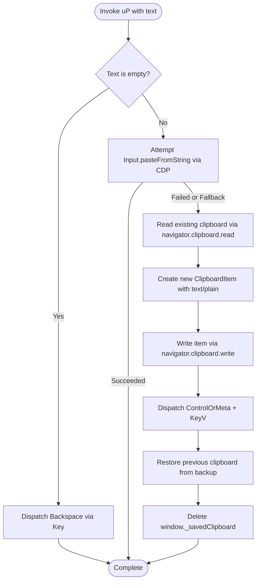

# 05 — Browser Action Engine & Input Emulation

## 1. Action Engine Architecture

The Comet Browser Action Engine is implemented in `class iP` inside `background.js`. It exposes two operational interfaces:
1. **Low-Level Anthropic Computer-Use Batching (`ComputerBatch`)**: High-throughput execution of mouse, keyboard, scrolling, drag-and-drop, and wait commands.
2. **High-Level Semantic Agent Tools**: Dedicated macro methods (`FormInput`, `Navigate`, `ReadPage`, `GetPageText`, `TabsCreate`).

All actions communicate directly with Chromium via Chrome DevTools Protocol 1.3 debugger sessions (`chrome.debugger.sendCommand`).

---

## 2. Complete Action Catalog

### ComputerBatch Primitive Actions

| Action Name | Input Schema | Underlying CDP Method | Behavioral Description |
|---|---|---|---|
| `SCREENSHOT` | `{}` | `Page.captureScreenshot` | Captures and scales current viewport screenshot without mutating DOM. |
| `WAIT` | `{ duration: number }` | `oj(duration * 1000)` | Asynchronously suspends action execution for specified seconds. |
| `LEFT_CLICK` | `{ coordinate?, ref? }` | `Input.dispatchMouseEvent` (`mousePressed`, `mouseReleased`) | Resolves coordinate or `ref`, scrolls into view, fires click feedback, and clicks. |
| `RIGHT_CLICK` | `{ coordinate?, ref? }` | `Input.dispatchMouseEvent` (`button: "right"`) | Opens context menus at resolved target coordinates. |
| `DOUBLE_CLICK` | `{ coordinate?, ref? }` | `Input.dispatchMouseEvent` (`clickCount: 2`) | Synthesizes double click for text selection or opening items. |
| `TRIPLE_CLICK` | `{ coordinate?, ref? }` | `Input.dispatchMouseEvent` (`clickCount: 3`) | Synthesizes triple click for full-line paragraph selection. |
| `TYPE` | `{ text: string }` | `uP()` (Paste string / Clipboard Swap) | Types text using high-fidelity clipboard injection with fallback. |
| `KEY` | `{ text: string }` | `Input.dispatchKeyEvent` (`rawKeyDown`, `keyUp`) | Dispatches single or chorded key sequences (e.g. `ControlOrMeta+KeyA`, `Enter`). |
| `SCROLL` | `{ coordinate, scroll_parameters }` | `Input.dispatchMouseEvent` (`type: "mouseWheel"`) | Dispatches mouse wheel delta events at target coordinate. |
| `LEFT_CLICK_DRAG` | `{ start_coordinate, coordinate }` | `Input.dispatchMouseEvent` + `Input.dispatchDragEvent` | Executes drag sequence with native drag-and-drop event interception. |
| `SCROLL_TO` | `{ ref: string }` | `DOM.resolveNode` + `scrollIntoView` | Instantly scrolls target element to the exact center of viewport. |

### High-Level Macro Tools

| Tool Method | Target Input | CDP Pipeline | Return Value |
|---|---|---|---|
| `FormInput` | `{ tab_id, ref, value }` | `dP` -> `$A` (`fP`/`pP`) -> `uP` | Updates form control value; triggers `input` and `change` events. |
| `Navigate` | `{ tab_id, url }` | `chrome.tabs.update`, `goBack`, `goForward` | Navigates tab; awaits DOM/FCP idle via `oN`; captures fresh screenshot. |
| `ReadPage` | `{ tab_id, filter, depth, ref_id }` | `gN` (`AXTree` + `DOMSnapshot`) | Compiles token-efficient structural YAML representation. |
| `GetPageText` | `{ tab_id }` | `dN` -> `DN` | Extracts full visible page text converted to Markdown. |
| `TabsCreate` | `{ url? }` | `chrome.tabs.create` + `oN` | Spawns new tab in current task group and captures initial state. |

---

## 3. High-Fidelity Typing Emulation (`uP`)

Web applications often install anti-bot event blockers or heavy React synthetic event listeners that ignore standard CDP `Input.insertText` or `Input.dispatchKeyEvent`. Comet solves this by using a **three-tier clipboard-swapping typing engine** (`uP`):



### Extracted Implementation Source:
```javascript
var uP = async (debuggee, text, selectAll = false, format = null) => {
  let keyboard = GN(debuggee, await pj());
  if (selectAll) {
    await keyboard.press("ControlOrMeta+KeyA");
  }
  if (text === "") {
    await keyboard.press("Backspace");
    return;
  }
  
  // Try direct CDP pasteFromString first (mj); fallback to clipboard swapping
  if (format || !(await mj(debuggee, text))) {
    // 1. Backup current clipboard
    await ej("paste", debuggee, async () => {
      try {
        window._savedClipboard = await navigator.clipboard.read();
      } catch {}
    });

    // 2. Write new payload into clipboard
    await ej("paste", debuggee, async (txt, mime) => {
      let item = new ClipboardItem({
        "text/plain": txt,
        ...(mime && { [mime]: txt })
      });
      await navigator.clipboard.write([item]);
    }, [text, format]);

    // 3. Dispatch native OS Paste shortcut
    await keyboard.press("ControlOrMeta+KeyV");

    // 4. Restore original user clipboard
    await ej("paste", debuggee, async () => {
      let saved = window._savedClipboard;
      if (saved) {
        try {
          await navigator.clipboard.write(saved);
        } finally {
          delete window._savedClipboard;
        }
      }
    });
  }
};
```

---

## 4. Drag-and-Drop Subsystem (`XN`)

Comet implements complete drag-and-drop interception using CDP's `Input.setInterceptDrags` domain:
1. Injects temporary main-world listeners (`setupDragListeners`) listening for `dragstart` and `mousemove`.
2. Calls `Input.setInterceptDrags({ enabled: true })`.
3. Dispatches `Input.dispatchMouseEvent` (`mousePressed`, `mouseMoved`).
4. If a drag operation is intercepted, `c` receives `Input.dragIntercepted` containing the drag payload.
5. Dispatches `Input.dispatchDragEvent` (`dragEnter`, `dragOver`, `drop`).
6. Cleans up event listeners and disables drag interception.

---

## 5. Select Dropdown Detection (`xP` & `SP`)

To handle native `<select>` controls that do not render options in the DOM tree when open:
1. `xP` injects a dynamic CSS stylesheet:
   ```css
   @keyframes _selectOpen { from { opacity: 1; } to { opacity: 1; } }
   select:open { animation: _selectOpen 1ms linear; }
   ```
2. Injects an `animationstart` listener listening for `_selectOpen`.
3. If triggered, `window._selectMeta.wasOpened` is set to `true`.
4. When `SP` checks the tab post-click, if `wasOpened === true`, Comet appends a system reminder to the LLM response:
   ```
   <system-reminder>Native select picker was opened. Screenshot may not include the picker. To interact use "ref" attribute with "form_input" action.</system-reminder>
   ```
