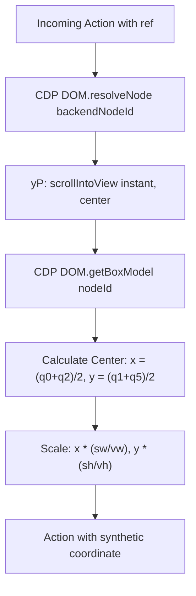

# 06 — Coordinate Geometry & Viewport Scaling

## 1. The Multi-Coordinate Problem

Browser automation agents operate across four fundamentally distinct coordinate spaces:
1. **Device Physical Pixels ($S_{	ext{physical}}$)**: The native hardware display resolution (e.g. Retina displays where DPR = 2.0).
2. **CSS Viewport Pixels ($S_{	ext{viewport}}$)**: The layout space utilized by DOM elements, `window.innerWidth`, and `visualViewport`.
3. **CDP Input Event Space ($S_{	ext{cdp}}$)**: The coordinates expected by CDP `Input.dispatchMouseEvent` (must match CSS Viewport Pixels).
4. **Model Image Space ($S_{	ext{model}}$)**: The downscaled image coordinates perceived by the multimodal model (e.g., Anthropic Claude Computer-Use $1568 	imes 1024$).

A mismatch of even 5 pixels results in broken interactions, clicking empty table cells, or missing buttons entirely.

---

## 2. Mathematical Scaling Formulation

### Viewport Measurement (`eP`)
Before executing actions or capturing screenshots, Comet calculates the true viewport dimensions taking into account scrollbars and fixed page chrome:
```javascript
let r = window.visualViewport.width;
let i = window.visualViewport.height;
viewportWidth = Math.round(r + offsetX);
viewportHeight = Math.round(i + offsetY);
```

### Scaling Multiplier ($\lambda$)
To fit within Anthropic's area ceiling ($ZN = 1.15 	imes 10^6 	ext{ px}$) and dimension ceiling ($QN = 1568 	ext{ px}$):
$$\lambda = \min\left(1.0, \sqrt{rac{1.15 	imes 10^6}{W_v 	imes H_v}}, rac{1568}{\max(W_v, H_v)}
ight)$$

$$	ext{screenshotWidth} = 	ext{round}(W_v 	imes \lambda)$$
$$	ext{screenshotHeight} = 	ext{round}(H_v 	imes \lambda)$$

### Model-to-CDP Coordinate Translation (`gP` & `hP`)
When the model returns click coordinates $(X_{	ext{model}}, Y_{	ext{model}})$, they reside in screenshot space. Comet translates them back into CSS viewport coordinates for CDP:

$$hP(v) = rac{	ext{viewportWidth}}{	ext{screenshotWidth}} = rac{1}{\lambda}$$
$$gP([X_{	ext{model}}, Y_{	ext{model}}], v) = \left[ X_{	ext{model}} 	imes hP(v), \; Y_{	ext{model}} 	imes hP(v) 
ight]$$

### Extracted Code:
```javascript
const hP = (v) => v.viewportWidth / v.screenshotWidth;

const gP = (coords, v) => {
  const scale = hP(v);
  return [coords[0] * scale, coords[1] * scale];
};
```

---

## 3. Element Reference Targeting (`vP` & `bP`)

When an action specifies a semantic element reference (`ref`) rather than absolute coordinates, Comet resolves the element to exact screenshot coordinates:



### Box Model Center Calculation (`bP`)
CDP `DOM.getBoxModel` returns the quad coordinates of the element's content box:
`model.content = [x1, y1, x2, y2, x3, y3, x4, y4]`
$$	ext{Center}_X = rac{x_1 + x_2}{2} = rac{content[0] + content[2]}{2}$$
$$	ext{Center}_Y = rac{y_1 + y_3}{2} = rac{content[1] + content[5]}{2}$$

### Normalization Routine (`vP`):
```javascript
var vP = async (tabId, viewport, action) => {
  if (!action.action || !["LEFT_CLICK", "RIGHT_CLICK"].includes(action.action) || !action.ref) {
    return action;
  }
  // 1. Resolve DOM node
  let { object, debuggee, nodeId } = await dP(tabId, action.ref);

  // 2. Scroll element to exact center
  await yP(debuggee, object.objectId);

  // 3. Obtain box model center in CSS viewport pixels
  let center = await bP(debuggee, nodeId);

  // 4. Project center into screenshot coordinates
  let scaleX = viewport.screenshotWidth / viewport.viewportWidth;
  let scaleY = viewport.screenshotHeight / viewport.viewportHeight;

  return {
    ...action,
    coordinate: [Math.round(scaleX * center[0]), Math.round(scaleY * center[1])]
  };
};
```

---

## 4. Viewport Drift Abort Gate (`_P`)

Webpages frequently dynamically resize, collapse headers, or trigger responsive layout shifts upon scrolling or lazy-loading images. If the viewport dimensions change between the time the model examined a screenshot and the time the batch executes, all coordinates are invalid.

Comet enforces an **atomic drift abort gate**:
```javascript
const _P = (lastViewport, currentViewport) => {
  return !!lastViewport && (
    lastViewport.viewportWidth !== currentViewport.viewportWidth ||
    lastViewport.viewportHeight !== currentViewport.viewportHeight
  );
};
```

In `iP.ComputerBatch`:
```javascript
let currentViewport = await eP(tabId, this.deps.logger);
let hasDrifted = _P(this.lastViewport, currentViewport);

if (actions.some(a => ["LEFT_CLICK", "RIGHT_CLICK", "DOUBLE_CLICK", "TRIPLE_CLICK", "SCROLL", "LEFT_CLICK_DRAG"].includes(a.action)) && hasDrifted) {
  let { screenshotUuid, base64_image, newViewportInfo } = await this.takeScreenshot(tabId);
  return {
    tab_context: await this.getTabContext(tabId, newViewportInfo),
    error: "Actions were not executed as viewport dimensions have been changed. Previous screenshots and coordinates are no longer valid. Use the new screenshot provided to continue.",
    base64_image: base64_image,
    screenshot_uuid: screenshotUuid
  };
}
```

---

## 5. Worked Numerical Example

### Scenario:
- Mac display: Retina Display ($DPR = 2.0$).
- Target browser window: $W_v = 1920	ext{ px}, \; H_v = 1080	ext{ px}$.
- Target DOM Button: Located at CSS Viewport $(x = 960, y = 540)$ with width $100	ext{ px}$, height $40	ext{ px}$.

### Step 1: Compute Area Budget & Screenshot Dimensions
$$	ext{Area} = 1920 	imes 1080 = 2,073,600 	ext{ px}$$
Since $	ext{Area} > 1.15 	imes 10^6$:
$$\lambda = \sqrt{rac{1,150,000}{2,073,600}} = \sqrt{0.5546} pprox 0.7447$$

$$	ext{screenshotWidth} = 	ext{round}(1920 	imes 0.7447) = 1430 	ext{ px}$$
$$	ext{screenshotHeight} = 	ext{round}(1080 	imes 0.7447) = 804 	ext{ px}$$

### Step 2: Element Center Projection into Model Image Space
$$C_X = 960 + rac{100}{2} = 1010 	ext{ px (CSS viewport)}$$
$$C_Y = 540 + rac{40}{2} = 560 	ext{ px (CSS viewport)}$$

$$	ext{Model}_X = 	ext{round}(1010 	imes 0.7447) = 752 	ext{ px}$$
$$	ext{Model}_Y = 	ext{round}(560 	imes 0.7447) = 417 	ext{ px}$$

### Step 3: Model Issues Action
Model returns: `LEFT_CLICK` at coordinate `[752, 417]`.

### Step 4: Translation to CDP Viewport Event
$$hP = rac{1920}{1430} pprox 1.342657$$
$$	ext{CDP}_X = 752 	imes 1.342657 = 1009.67 pprox 1010 	ext{ px}$$
$$	ext{CDP}_Y = 417 	imes 1.342657 = 559.88 pprox 560 	ext{ px}$$

The mouse event lands precisely at $(1010, 560)$, exactly at the center of the target button.
