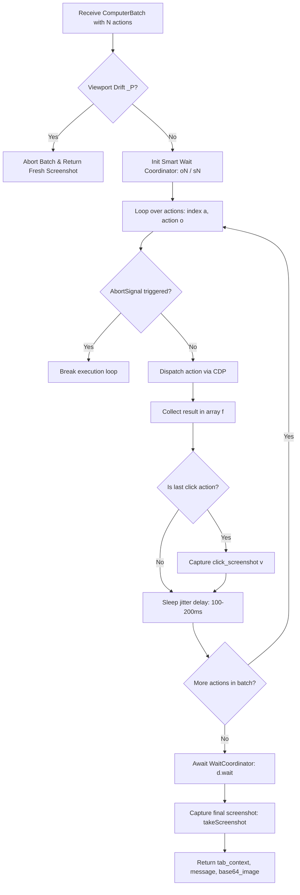

# 07 — Action Batching & Smart Waiting Heuristics

## 1. ComputerBatch Control Flow

Modern web automation requires balancing two contradictory requirements:
1. **Low Latency & High Throughput**: Round-tripping every single mouse movement or keystroke back to a remote LLM incurs 1–3 seconds of latency per step.
2. **Safety & DOM Settling**: Blasting commands without waiting for network responses or DOM mutations causes misclicks on displaced elements.

Comet resolves this with Anthropic-style **Action Batching** managed by `iP.ComputerBatch`:



---

## 2. Inter-Action Jitter Delays

Between successive actions in a single batch, Comet injects a randomized human-like jitter delay:
```javascript
let tP = 100; // Base delay: 100ms
let d = Math.floor(Math.random() * 101) + tP; // 100ms - 200ms
if (a !== actions.length - 1) {
  await oj(d); // Sleep promise
}
```
This randomized delay prevents bot detection systems from identifying machine-cadence interactions while allowing rapid sequential typing and button clicking.

---

## 3. The Smart Wait Coordinator (`oN` & `sN`)

Naive automation relies on fixed `sleep(3000)` calls, which waste time on fast sites and fail on slow ones. Comet implements an **event-driven CDP Smart Wait Coordinator** (`oN` wrapping `sN`).

### CDP Event Listener Heuristics
`sN` binds directly to `chrome.debugger.onEvent` and listens for critical browser rendering and navigation events:
- `Page.frameAttached` / `Page.frameDetached`: Tracks frame lifecycles in a `Map`.
- `Page.navigatedWithinDocument`: Detects Single Page Application client-side route transitions (`historyApi`).
- `Page.domContentEventFired`: Flags initial DOM readiness.
- `Accessibility.loadComplete`: Triggers a 350ms quiescence debounce window.
- `Accessibility.nodesUpdated`: Triggers a 250ms debounce window.

### Extracted Implementation Source:
```javascript
function oN(tabOptions) {
  return sN(tabOptions, {
    idleTimeout: 500,
    concurrency: 0
  });
}

function sN({ tabContext, config, onFirstPaint }, options) {
  let startTime = performance.now();
  let doneResolver = () => {};
  let timerId = null;
  let activeFrames = new Map();
  let fcpReceived = false;

  const clearTimer = () => { if (timerId) clearTimeout(timerId); };
  
  const scheduleIdleCheck = (delay = 500) => {
    clearTimer();
    timerId = setTimeout(() => {
      if (activeFrames.size === 0) {
        doneResolver(true);
      }
    }, delay);
  };

  const handleAccessibilityEvent = (tab, eventName) => {
    let canProcess = !config.waitForFCP || fcpReceived;
    if (eventName === "Accessibility.loadComplete") {
      fcpReceived = true;
      scheduleIdleCheck(350);
    } else if (eventName === "Accessibility.nodesUpdated" && canProcess) {
      scheduleIdleCheck(250);
    }
  };

  // Host-specific overrides (e.g. Gmail, Amazon require tuned accessibility debouncing)
  function getCustomEventFilter(url) {
    if (["https://mail.google.com/", "https://www.amazon.com/"].some(u => url.startsWith(u))) {
      return handleAccessibilityEvent;
    }
    return null;
  }

  function onDebuggerEvent(source, method, params) {
    if (source.tabId === tabContext.tabId && params) {
      if (method === "Page.frameAttached") {
        activeFrames.set(params.frameId, undefined);
      }
      if (method === "Page.frameDetached") {
        activeFrames.delete(params.frameId);
        scheduleIdleCheck(100);
      }
      if (method === "Page.navigatedWithinDocument" && params.navigationType === "historyApi") {
        scheduleIdleCheck(500);
      }
    }
  }

  chrome.debugger.onEvent.addListener(onDebuggerEvent);

  return {
    wait: () => new Promise((resolve) => {
      doneResolver = () => {
        chrome.debugger.onEvent.removeListener(onDebuggerEvent);
        clearTimer();
        resolve(true);
      };
      // Timeout fallback: maxWaitingTimeoutMs (default 2500ms - 5000ms)
      setTimeout(doneResolver, config.maxWaitingTimeoutMs ?? 2500);
    })
  };
}
```

---

## 4. Dual-Screenshot Verification Heuristic

When the batch contains a click action, Comet captures two screenshots:
1. **Immediate Click Screenshot ($v$)**: Taken immediately following the final click in the batch (`timeout: 1000ms`).
2. **Settled Final Screenshot ($ee$)**: Taken after `d.wait()` confirms DOM and accessibility idle (`timeout: 10000ms`).

If the DOM has not changed or if latency between click and final capture is less than `nP = 1000ms`:
```javascript
let isFastReaction = !!v && !!lastClickTime && (performance.now() - lastClickTime < nP);
let { base64_image, newViewportInfo } = await this.takeScreenshot(tabId, {
  screenshotUuid: uuid,
  dontSaveToStorage: isFastReaction,
  clickCoordinate: isFastReaction ? lastClickCoord : undefined,
  timeout: 10000
});
```
This optimization saves storage bandwidth and model inference tokens by suppressing redundant intermediate frames.
